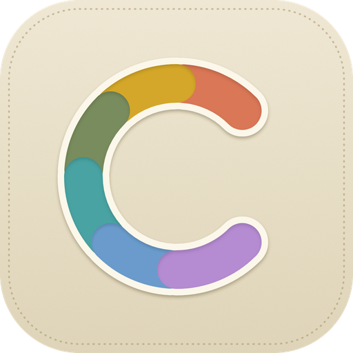

<p align="center"></p>

# Cénacle

[English](README.md) · **Français**

[](https://github.com/Jeromearsene/cenacle-AI/actions/workflows/ci.yml)
[](LICENSE)


Application de bureau multiplateforme (Electron) pour utiliser plusieurs comptes d'assistants IA dans une seule fenêtre. **Claude**, **ChatGPT** et **Gemini** sont pris en charge aujourd'hui, et d'autres services s'ajoutent avec une seule entrée (voir [Ajouter un service](#ajouter-un-service)). Chaque compte a sa propre session isolée (cookies, stockage local), donc des comptes différents, y compris chez le même service, ne se mélangent pas.

**Projet non officiel.** Il n'est affilié ni à Anthropic, ni à OpenAI, ni à Google. Les noms Claude, ChatGPT, Gemini et ceux de tout autre service appartiennent à leurs propriétaires respectifs. L'application n'utilise aucune API : elle affiche les sites publics, comme un navigateur. Lis les conditions d'utilisation de chaque service avant de t'en servir.

## Services

| Service | État         | Remarques                                                                                             |
| ------- | ------------ | ----------------------------------------------------------------------------------------------------- |
| Claude  | testé        | Connexion par lien magique conseillée (voir plus bas).                                                |
| ChatGPT | à tester     | Connexion par e-mail. Les boutons « Continuer avec Google / Apple / Microsoft » peuvent être refusés. |
| Gemini  | expérimental | Connexion Google : voir « Gemini et la connexion Google ».                                            |

## Ajouter un service

Les services sont de simples données dans `src/main/providers.ts`. Pour en ajouter un (Grok, Perplexity, un chat auto-hébergé…), ajoute une entrée :

```ts
example: {
  id: 'example',                    // clé en minuscules, identique à la clé de l'objet
  label: 'Example',                 // nom affiché dans la barre latérale et les menus
  url: 'https://chat.example.com/', // https uniquement
  ua: 'clean',                      // identifiant de navigateur, voir plus bas
  authHosts: ['login.example.com'], // facultatif : domaines de connexion propres au service
},
```

- `ua` : commence par `'clean'`. Si le service refuse la connexion (Google le fait), essaie `'native'`.
- `authHosts` : les popups de connexion qui s'ouvrent sur ces domaines restent dans l'app, dans la session du bon compte. Les connexions Google, Microsoft et Apple sont déjà gérées pour tous les services.
- Lance `yarn test:e2e` : un test vérifie que chaque entrée est bien formée. Puis ouvre une pull request.

## Plateformes

| Plateforme | État                                                                                                    |
| ---------- | ------------------------------------------------------------------------------------------------------- |
| macOS      | plateforme principale, utilisée et testée au quotidien par l'auteur                                     |
| Linux      | prise en charge ; les tests de bout en bout tournent sous Linux en CI                                   |
| Windows    | prise en charge ; les tests de bout en bout tournent sous Windows en CI, mais l'auteur ne l'utilise pas |

Aucun installateur n'est publié pour l'instant : l'app se lance depuis les sources (ci-dessous). Les remarques propres à une plateforme sont signalées « macOS », « Windows » ou « Linux ».

## Lancer

```bash
yarn install
yarn dev        # développement : rechargement à chaud de l'interface
yarn build      # construit dans out/
yarn start      # lance l'app construite
```

Le projet utilise Yarn 4 (4.18.1), avec `nodeLinker: node-modules` dans `.yarnrc.yml` : Electron ne fonctionne pas avec le mode Plug'n'Play.

**Versions fixées**

- Avec [Volta](https://volta.sh) : la clé `volta` de `package.json` fixe Node (22.23.5) et Yarn (4.18.1).
- Sans Volta : `corepack enable` suffit, le champ `packageManager` indique la version de Yarn.
- Volta ne documente clairement que Yarn 1.x et 3 et plus. Si Volta n'arrive pas à récupérer Yarn 4, supprime la ligne `"yarn"` de la clé `volta` et passe par Corepack.

**Délai de sécurité de Yarn** : par défaut, Yarn 4 refuse les versions publiées depuis moins de 24 h (`npmMinimalAgeGate`). Electron est indiqué en `^45.3.3` ; `yarn up electron` le met à jour quand la dernière version est assez ancienne.

Le binaire d'Electron (environ 100 Mo) est téléchargé par `yarn install` (script `postinstall`). Si le téléchargement a échoué ou n'a pas eu lieu, `node node_modules/electron/install.js` le relance ; sans lui, `yarn dev` et `yarn start` s'arrêtent avec « Electron uninstall ».

## Utilisation

- **+ Ajouter un compte** demande le service, puis crée une session vide. Connecte-toi une fois, elle est conservée entre deux lancements.
- **Un seul / Colonnes** : un compte à la fois, ou tous côte à côte (pratique pour comparer des réponses).
- Double-clic sur un nom (ou ✎) pour renommer, ✕ pour supprimer la session d'un compte.
- **Fenêtre** : au premier lancement elle occupe toute la zone utile de l'écran (sous la barre de menus et le Dock, ou la barre des tâches). Ensuite, l'app retrouve sa dernière taille, ou son état agrandi / plein écran. Si l'écran utilisé a été débranché, elle revient sur l'écran principal.
- Plein écran : bouton vert (macOS), ⌃⌘F / F11 ou menu Affichage. Agrandir : double-clic sur la barre du haut (macOS) ou sur la barre de titre (Windows, Linux).
- Les comptes masqués restent chargés : leurs conversations continuent en arrière-plan.
- **Clic droit** dans une page de service : menu contextuel avec couper / copier / coller, suggestions d'orthographe, ouvrir ou copier un lien, copier une image, inspecter l'élément.

Sur macOS, ⌘ est la touche Commande ; sous Windows et Linux, utilise Ctrl à la place.

| Raccourci               | Action                                  |
| ----------------------- | --------------------------------------- |
| ⌘1 … ⌘9 / Ctrl+1 … 9    | Aller au compte n                       |
| Ctrl+Tab / Ctrl+Maj+Tab | Compte suivant / précédent              |
| ⌘Maj+L / Ctrl+Maj+L     | Basculer un seul / colonnes             |
| ⌘R / Ctrl+R             | Recharger le compte actif               |
| ⌘+ ⌘- ⌘0 / Ctrl+ + - 0  | Zoom du compte actif                    |
| ⌘⌥I / Ctrl+Alt+I        | Outils de développement du compte actif |
| ⌃⌘F (macOS) / F11       | Plein écran                             |

Nouveau compte : menu Comptes → Nouveau compte, ou bouton de la barre latérale.

> L'interface est pour l'instant uniquement en français. Sa traduction est dans la feuille de route.

## Gemini et la connexion Google

Google refuse la connexion depuis un navigateur intégré (« Ce navigateur ou cette application ne sont peut-être pas sécurisés »). Dans cette application, les services Claude et ChatGPT envoient un identifiant de navigateur « nettoyé » (sans `Electron/x`), qui passe mieux les contrôles anti-robots. Pour Google, c'est l'inverse : des retours d'expérience d'autres projets Electron indiquent que Google accepte l'identifiant d'Electron laissé tel quel et refuse l'identifiant nettoyé ([exemple](https://github.com/stablyai/orca/issues/11518)).

Le service Gemini utilise donc l'identifiant natif d'Electron (`ua: 'native'` dans `src/main/providers.ts`). C'est **expérimental** : la règle de Google n'est pas documentée et peut changer. Si la connexion échoue quand même :

- ouvre une issue en précisant le message affiché ;
- ou passe `ua` à `'clean'` dans `src/main/providers.ts` pour comparer ;
- les connexions via « Continuer avec Google » dans Claude ou ChatGPT utilisent l'identifiant nettoyé du service et risquent d'être refusées : préfère l'e-mail.

## Mots de passe et clés d'accès

Ce qui **ne fonctionne pas** aujourd'hui, et pourquoi :

- **Le remplissage automatique des mots de passe du système (macOS : app Mots de passe d'Apple / trousseau iCloud)** n'est pas proposé dans les apps Electron. Electron a une demande de fonctionnalité ouverte pour les fournisseurs de mots de passe macOS sur les champs HTML ([electron/electron#54142](https://github.com/electron/electron/issues/54142)). Pour les moteurs de navigateur tiers, l'intégration d'iCloud Passwords exige en plus un droit restreint (`com.apple.developer.browser`) qu'Apple accorde sur demande, comme l'a documenté un autre navigateur basé sur Chromium ([ego-lite#362](https://github.com/citrolabs/ego-lite/issues/362)).
- **Touch ID et clés d'accès** : Electron ne les propose qu'après `app.configureWebAuthn`, et elles exigent une app signée avec des droits Apple. Les clés d'accès déjà enregistrées dans ton trousseau iCloud n'apparaîtraient pas. Sur l'écran de connexion Google, choisis « Essayer une autre méthode » et utilise ton mot de passe avec la validation en deux étapes.

Ce que tu peux faire :

- Copier le mot de passe depuis ton gestionnaire, puis coller avec ⌘V ou clic droit → Coller (le menu contextuel est là pour ça).
- Gestionnaires tiers : le remplissage universel de 1Password (⌘\) est signalé comme fonctionnel dans certaines apps Electron signées (même ticket #54142) ; il n'a **pas** été testé avec cette app.

## Permissions

Les pages des services sont des sites web : l'app ne leur accorde que ce qu'un chat demande, c'est-à-dire les notifications, le copier-coller, le plein écran et le **micro** (mode vocal). La caméra, le partage d'écran, la localisation et toutes les autres permissions sont refusés. Seule la page elle-même, pas un cadre tiers qu'elle intègre, peut utiliser les notifications ou le micro. La règle est dans `src/main/permissions.ts`.

## Où sont les données

- Sessions : dossier `Partitions/` dans le dossier de données de l'app. Une partition par compte.
  - macOS : `~/Library/Application Support/Cénacle/`
  - Windows : `%APPDATA%\Cénacle\`
  - Linux : `~/.config/Cénacle/`
- Liste des comptes, mise en page, taille de fenêtre : `state.json` dans le même dossier.
- Les données de session ne sont jamais dans le dossier du projet.

## Limites connues

- Les popups de connexion (domaines listés dans `src/main/providers.ts`, chemins du type `/oauth`, `/authorize`, `/login`) s'ouvrent dans l'app, dans la session du bon compte. Les autres liens s'ouvrent dans le navigateur par défaut. C'est une heuristique : si un lien s'ouvre du mauvais côté, ajuste `AUTH_HOSTS` (`src/main/providers.ts`) ou `OAUTH_PATH` (`src/main/index.ts`).
- Les sites changent sans prévenir : le rendu peut évoluer, mais l'outil lui-même ne dépend d'aucune API.
- Les services peuvent exiger une vérification anti-robot (Cloudflare, par exemple) selon ton réseau.

## Automatisation (Playwright / Puppeteer), désactivée par défaut

```bash
CENACLE_DEBUG_PORT=9222 yarn dev
```

Cela ouvre le protocole de débogage Chrome sur `127.0.0.1:9222` uniquement. Exemple :

```js
const { chromium } = require('playwright-core');

const browser = await chromium.connectOverCDP('http://127.0.0.1:9222');
for (const context of browser.contexts()) {
  for (const page of context.pages()) console.log(page.url());
}
```

Attention : tout processus local qui atteint ce port contrôle toutes les sessions connectées. Ne laisse pas la variable définie en permanence. Vérifie aussi les conditions d'utilisation des services avant d'automatiser quoi que ce soit.

## Développement

Pile : Electron, TypeScript (strict), [electron-vite](https://electron-vite.org), Preact, Tailwind CSS 4, [Biome](https://biomejs.dev) (lint et formatage), Playwright. L'interface (barre latérale) pèse une trentaine de Ko de JavaScript ; les pages des services sont de vraies pages web, sans code de notre part.

```bash
yarn lint        # Biome : lint + vérification du format (yarn lint:fix pour corriger, yarn format pour formater)
yarn typecheck   # TypeScript, processus principal + interface
yarn check       # lint + typecheck
yarn test:e2e    # construit l'app puis lance les tests de bout en bout
```

Les tests lancent l'app Electron avec Playwright, contre un faux service local (variable `MULTI_TEST_URL`, ignorée dans une app empaquetée) : aucun accès réseau ni compte réel. Ils vérifient l'ajout et le renommage d'un compte, la mise en colonnes, l'isolation des cookies et du stockage entre comptes, l'identifiant de navigateur de chaque service, la persistance après redémarrage et le menu du clic droit. Sous Linux sans écran : `xvfb-run -a yarn test:e2e` (les tests ajoutent `--no-sandbox` tout seuls quand ils tournent en root ou en CI). Sous Linux, si Electron s'arrête au démarrage avec une erreur « SUID sandbox helper » (fréquent sur Ubuntu récent), lance `yarn dev --no-sandbox`.

**Intégration continue** (`.github/workflows/ci.yml`) : à chaque envoi sur `main` et à chaque pull request, lint et format, vérification des types et build sous Linux, puis tests de bout en bout sous macOS, Linux et Windows. Dependabot propose chaque semaine les mises à jour des dépendances.

```
src/main/index.ts                 processus principal : fenêtre, une vue par compte, mise en page, menu
src/main/providers.ts             services pris en charge (URL, identifiant de navigateur, domaines de connexion)
src/main/permissions.ts            permissions accordées aux pages des services
src/main/state.ts                 lecture / validation / écriture de state.json
src/main/context-menu*.ts         menu du clic droit (modèle pur + branchement)
src/preload/index.ts              pont minimal vers l'interface (contextBridge)
src/shared/types.ts               types partagés entre les trois
src/renderer/                     interface Preact + Tailwind (barre latérale, en-têtes de colonnes)
resources/                        icône de l'app (source SVG, PNG, ICO, ICNS)
e2e/                              tests Playwright
.github/                          workflow CI et Dependabot
```

## Feuille de route

- Mémoire partagée entre comptes via un serveur MCP commun (selon la prise en charge des connecteurs par chaque service et chaque forfait).
- Suivi des quotas par compte, temps restant avant la prochaine utilisation, notification quand un compte redevient utilisable.
- Icône dans la barre de menus, bascule manuelle clair / sombre, raccourcis personnalisables.
- Traduction de l'interface (anglais / français).
- Paquets installables pour macOS, Linux et Windows (electron-builder ou Electron Forge).
- Autres services.

## Licence

[CC BY-NC-SA 4.0](LICENSE) (Creative Commons Attribution - Pas d'Utilisation Commerciale - Partage dans les Mêmes Conditions 4.0).

- **Attribution** : conserve le fichier [NOTICE](NOTICE) et cite le projet d'origine ([Cénacle](https://github.com/Jeromearsene/cenacle-AI)) et son auteur dans toute copie, fork ou dérivé.
- **Pas d'utilisation commerciale** : tout usage commercial exige un accord séparé et une juste rémunération. Pour demander une licence commerciale, ouvre une issue.
- **Partage dans les mêmes conditions** : si tu modifies le projet et distribues le résultat, tu dois publier tes modifications sous la même licence. Les pull requests sur ce dépôt sont bienvenues mais pas obligatoires.

À cause de la clause « pas d'utilisation commerciale », c'est une licence _à code source disponible_, pas une licence « open source » au sens de l'[OSI](https://opensource.org/osd). En contribuant, tu acceptes que ta contribution soit publiée sous la même licence et que l'auteur puisse aussi la proposer sous une licence commerciale séparée.
