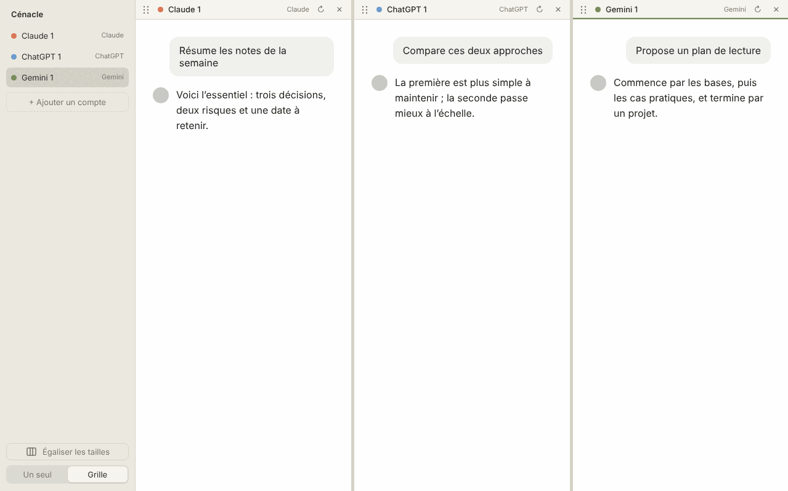

<h1 align="center">Cénacle</h1>

  <strong>Tous tes assistants IA, côte à côte, dans une seule fenêtre.</strong> 
  Plusieurs comptes Claude, ChatGPT et Gemini, chacun dans sa session isolée.

<a href="README.md">English</a> · <strong>Français</strong>

  
  
  
  

Un forfait gratuit ici, un compte pro là, un compte perso à côté. Cénacle les réunit dans une seule fenêtre : passe de l'un à l'autre avec un raccourci, ou place-les côte à côte pour comparer les réponses de plusieurs assistants à la même question. Rien ne se mélange : chaque compte garde sa propre session.

  <picture>
    <source media="(prefers-color-scheme: dark)" srcset="docs/images/fr-grid-dark.png">
    
  </picture>

## ✨ Fonctionnalités

- **Plusieurs comptes, une fenêtre** : Claude, ChatGPT et Gemini, y compris plusieurs comptes du même service.
- **Sessions isolées** : chaque compte a ses propres cookies et son propre stockage. Tu te connectes une fois, c'est retenu.
- **Une grille que tu organises** : glisse-dépose les comptes pour former des rangées et des colonnes, échange-les, redimensionne-les. La disposition est conservée d'un lancement à l'autre.
- **Les limites d'utilisation d'un coup d'œil** : quand Claude annonce que tu approches de ta limite, le compte affiche une pastille, l'heure de retour et un sablier, et tu es notifié quand il est de nouveau utilisable.
- **Des notifications qu'on distingue** : le nom et la couleur du compte sur chaque notification ; un clic t'amène au bon compte.
- **Rapide à piloter** : ⌘1…⌘9 pour aller à un compte, Ctrl+Tab pour les parcourir. Les comptes masqués continuent de tourner : une longue réponse n'est pas interrompue.
- **Privé par conception** : pas d'API, pas de clé, pas de serveur chez nous. L'app affiche les sites des services eux-mêmes, avec seulement les permissions dont un chat a besoin.
- **Multiplateforme, en français et en anglais** : macOS, Windows et Linux.

## ⬇️ Télécharger

Récupère le dernier installateur sur la [page des versions](https://github.com/Jeromearsene/cenacle-AI/releases/latest) :

| Système | Fichier                         |
| ------- | ------------------------------- |
| macOS   | `.dmg` (Apple Silicon et Intel) |
| Windows | installateur `.exe`             |
| Linux   | AppImage ou `.deb`              |

L'app n'est **pas encore signée** : macOS et Windows t'avertissent au premier lancement, voici [comment l'ouvrir](docs/fr/install.md#plateformes). Elle se met à jour toute seule sous Windows et Linux ; sous macOS, tant qu'elle n'est pas signée, télécharge chaque nouvelle version. Tu préfères la construire toi-même ? Voir [Développement](docs/fr/development.md#lancer-depuis-les-sources).

## Services pris en charge

**Claude**, **ChatGPT** et **Gemini** aujourd'hui. Un autre service tient en une seule entrée dans le code ([comment en ajouter un](docs/fr/services.md#ajouter-un-service)) : Grok, Perplexity, un chat auto-hébergé…

## 📚 Documentation

- [Installation](docs/fr/install.md) : plateformes, premier lancement sous macOS, mises à jour.
- [Utiliser Cénacle](docs/fr/usage.md) : comptes, raccourcis, notifications, limites d'utilisation, langue.
- [La grille](docs/fr/grid.md) : organiser, redimensionner et retirer des cases.
- [Services](docs/fr/services.md) : ce qui est pris en charge, ajouter un service, Gemini et la connexion Google, limites connues.
- [Vie privée, permissions et connexion](docs/fr/privacy.md) : isolation, permissions, mots de passe et clés d'accès, où sont tes données.
- [Développement](docs/fr/development.md) : construire depuis les sources, tests, versions, organisation du projet.
- [Contribuer](CONTRIBUTING.md) · [Politique de sécurité](SECURITY.md) · [Journal des changements](CHANGELOG.md)

## Feuille de route

- Mémoire partagée entre les comptes via un serveur MCP commun.
- Limites d'utilisation pour ChatGPT et Gemini (Claude seulement pour l'instant).
- Icône dans la barre de menus, raccourcis personnalisables.
- Signature et notarisation du code (nécessaires aux mises à jour macOS, à Touch ID et aux clés d'accès).
- D'autres services.

## ☕ Soutenir le projet

Si Cénacle te sert, tu peux soutenir son développement :

## ⭐ Historique des étoiles

## Projet non officiel

Cénacle n'est affilié ni à Anthropic, ni à OpenAI, ni à Google. Les noms Claude, ChatGPT, Gemini et ceux de tout autre service appartiennent à leurs propriétaires respectifs. L'application n'utilise aucune API : elle affiche les sites publics, comme un navigateur. Lis les conditions d'utilisation de chaque service avant de t'en servir.

## Licence

[CC BY-NC-SA 4.0](LICENSE) (Creative Commons Attribution - Pas d'Utilisation Commerciale - Partage dans les Mêmes Conditions 4.0).

- **Attribution** : conserve le fichier [NOTICE](NOTICE) et cite le projet d'origine ([Cénacle](https://github.com/Jeromearsene/cenacle-AI)) et son auteur dans toute copie, fork ou dérivé.
- **Pas d'utilisation commerciale** : tout usage commercial exige un accord séparé et une juste rémunération. Pour demander une licence commerciale, ouvre une issue.
- **Partage dans les mêmes conditions** : si tu modifies le projet et distribues le résultat, tu dois publier tes modifications sous la même licence. Les pull requests sur ce dépôt sont bienvenues mais pas obligatoires.

À cause de la clause « pas d'utilisation commerciale », c'est une licence _à code source disponible_, pas une licence « open source » au sens de l'[OSI](https://opensource.org/osd). Pour proposer un changement, lis [CONTRIBUTING.md](CONTRIBUTING.md) (en anglais). En contribuant, tu acceptes que ta contribution soit publiée sous la même licence et que l'auteur puisse aussi la proposer sous une licence commerciale séparée.
