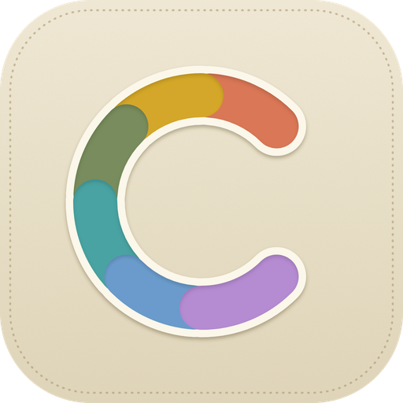
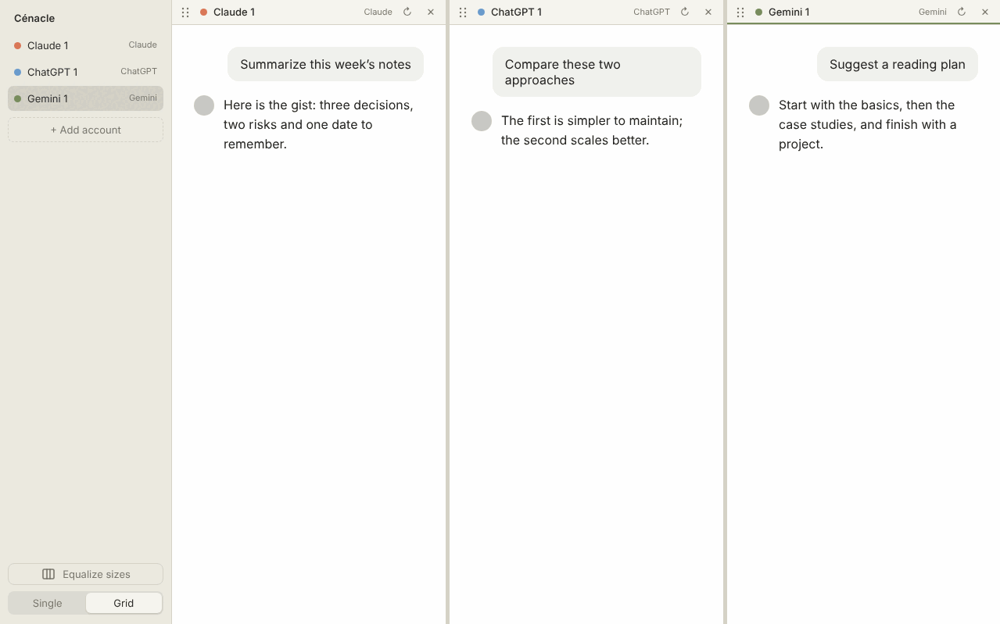

<h1 align="center">Cénacle</h1>

  <strong>All your AI assistants, side by side, in a single window.</strong> 
  Several Claude, ChatGPT and Gemini accounts, each in its own isolated session.

<strong>English</strong> · <a href="README.fr.md">Français</a>

  
  
  
  

A free plan here, a work account there, a personal one on the side. Cénacle puts them all in one window: switch with a shortcut, or lay them out side by side to compare the answers of several assistants to the same question. Nothing gets mixed up: every account keeps its own session.

  <picture>
    <source media="(prefers-color-scheme: dark)" srcset="docs/images/grid-dark.png">
    
  </picture>

## ✨ Features

- **Many accounts, one window**: Claude, ChatGPT and Gemini, including several accounts of the same service.
- **Isolated sessions**: each account has its own cookies and storage. Sign in once, it is remembered.
- **A grid you arrange yourself**: drag and drop accounts to build rows and columns, swap them, resize them. The layout is kept between launches.
- **Usage limits at a glance**: when Claude says you are close to your limit, the account shows a pill, the time it comes back and an hourglass, and you get a notification when it is usable again.
- **Notifications you can tell apart**: the account's name and color on every notification; a click brings you to the right account.
- **Fast to drive**: ⌘1…⌘9 to jump to an account, Ctrl+Tab to cycle. Hidden accounts keep running, so a long answer is not interrupted.
- **Private by design**: no API, no key, no server of ours. The app shows the services' own websites, with only the permissions a chat needs.
- **Cross-platform, in English and French**: macOS, Windows and Linux.

## ⬇️ Download

Get the latest installer from the [releases page](https://github.com/Jeromearsene/cenacle-AI/releases/latest):

| System  | File                             |
| ------- | -------------------------------- |
| macOS   | `.dmg` (Apple Silicon and Intel) |
| Windows | `.exe` installer                 |
| Linux   | AppImage or `.deb`               |

The app is **not code-signed yet**, so macOS and Windows warn you at the first launch: [here is how to open it](docs/install.md#platforms). It updates itself on Windows and Linux; on macOS, until it is signed, download each new version. Prefer building it yourself? See [Development](docs/development.md#run-from-source).

## Works with

**Claude**, **ChatGPT** and **Gemini** today. Another service is a single entry in the code ([how to add one](docs/services.md#adding-a-service)): Grok, Perplexity, a self-hosted chat…

## 📚 Documentation

- [Installation](docs/install.md): platforms, first launch on macOS, updates.
- [Using Cénacle](docs/usage.md): accounts, shortcuts, notifications, usage limits, language.
- [The grid](docs/grid.md): arrange, resize and remove cells.
- [Services](docs/services.md): what is supported, adding a service, Gemini and Google sign-in, known limits.
- [Privacy, permissions and sign-in](docs/privacy.md): isolation, permissions, passwords and passkeys, where your data lives.
- [Development](docs/development.md): build from source, tests, releases, project layout.
- [Contributing](CONTRIBUTING.md) · [Security policy](SECURITY.md) · [Changelog](CHANGELOG.md)

## Roadmap

- Shared memory between accounts through a common MCP server.
- Usage limits for ChatGPT and Gemini (Claude only for now).
- Menu bar icon, customizable shortcuts.
- Code signing and notarization (needed for macOS updates, Touch ID and passkeys).
- More services.

## ☕ Sponsors

If you find Cénacle useful, consider supporting its development:

## ⭐ Star History

## Unofficial project

Cénacle is not affiliated with Anthropic, OpenAI or Google. The names Claude, ChatGPT, Gemini and any other service name belong to their respective owners. The app uses no API: it displays the public websites, like a browser would. Read each service's terms of use before relying on it.

## License

[CC BY-NC-SA 4.0](LICENSE) (Creative Commons Attribution-NonCommercial-ShareAlike 4.0).

- **Attribution**: keep the [NOTICE](NOTICE) and credit the original project ([Cénacle](https://github.com/Jeromearsene/cenacle-AI)) and its author in any copy, fork or derivative.
- **NonCommercial**: you may not use it for commercial purposes without a separate agreement and fair payment. To ask for a commercial license, open an issue.
- **ShareAlike**: if you modify it and distribute the result, you must publish your changes under the same license. Pull requests to this repository are welcome but not required.

Because of the NonCommercial clause, this is a _source-available_ license, not an [OSI](https://opensource.org/osd) "open source" one. See [CONTRIBUTING.md](CONTRIBUTING.md) to propose a change. By contributing, you agree that your contribution is released under the same license and that the author may also offer it under a separate commercial license.
