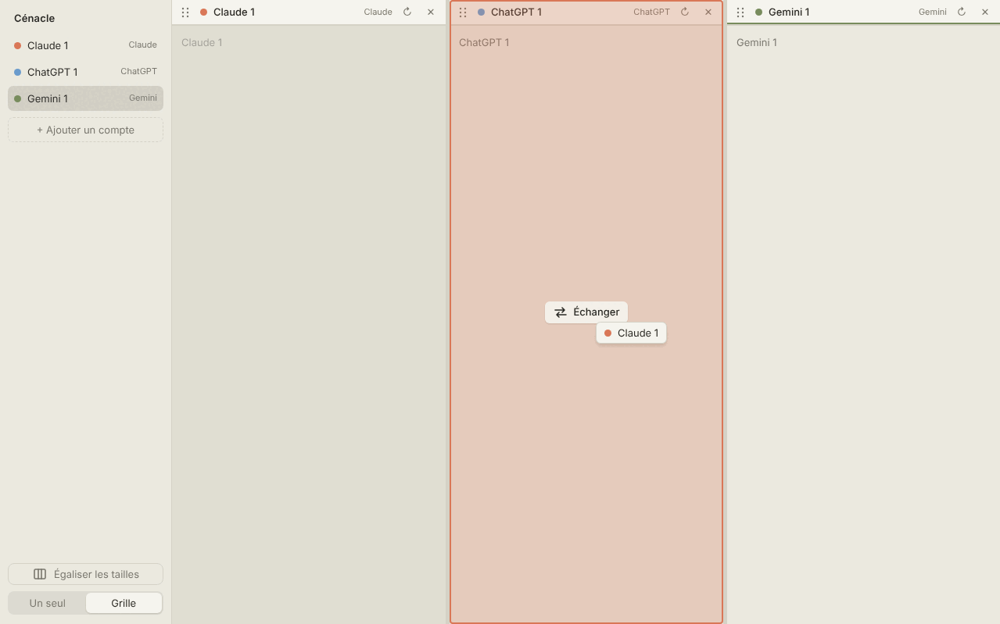

# La grille

[English](../grid.md) · **Français**

← [Retour au README](../../README.fr.md)

En mode **Grille**, chaque compte est une case avec son en-tête. Au départ elles sont côte à côte (sur plusieurs rangées si elles ne tiennent pas toutes) ; tu les organises ensuite :

- **Déplacer** : glisse un compte depuis la barre latérale, ou un en-tête de case (la poignée de déplacement sur la rangée du haut sous macOS, où elle déplace la fenêtre), sur la grille. La zone en surbrillance montre où il ira :
  - sur un **bord de case** : coupe cette case (gauche / droite : côte à côte, haut / bas : empilées) ;
  - au **centre** d'une case : échange les deux cases (ou, pour un compte absent de la grille, remplace la case) ;
  - le long du **bord extérieur de la grille** : une nouvelle rangée ou colonne sur toute la grille.
- **Cases lisibles** : une case ne descend jamais sous 320 × 240 px. Un dépôt qui écraserait une case est signalé comme refusé (« Pas assez de place ») et ne fait rien ; la même limite bloque les poignées de redimensionnement.
- **Redimensionner** : glisse la poignée entre deux cases, ou donne-lui le focus (Tab) et utilise les flèches. Double-clic sur une poignée, bouton **Égaliser les tailles** dans la barre latérale, ou Affichage → Égaliser la taille des cases pour répartir l'espace à parts égales. Les tailles sont conservées d'un lancement à l'autre, comme la disposition.
- **Retirer** : le ✕ de l'en-tête retire le compte de la grille. Il reste dans la barre latérale (point creux, grisé, session conservée) et ne revient qu'en le glissant sur la grille : un clic dessus ne fait rien. La dernière case ne peut pas être retirée.
- **Réinitialiser** : Affichage → Réinitialiser la grille remet tous les comptes comme au départ.
- Un nouveau compte est ajouté à la grille s'il y a la place.

Les changements de disposition se font en douceur plutôt que d'un coup (sauf si le système demande de réduire les animations).

_Glisser « Claude 1 » sur le centre de « ChatGPT 1 » propose de les échanger. Le contenu des pages est un texte de démonstration._

Les pages des services sont masquées pendant le glissement, pour que l'interface suive la souris ; elles reviennent au relâchement. Échap annule un glissement.
