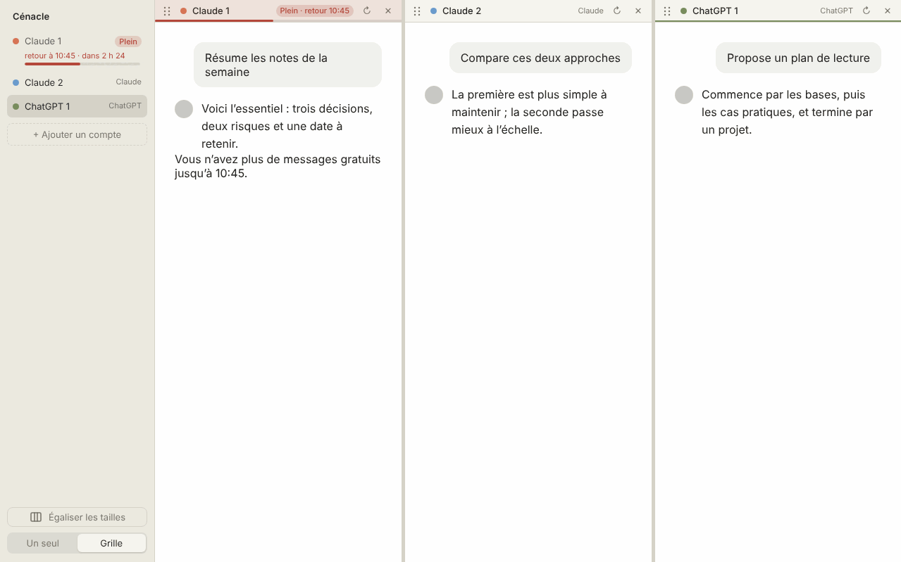

# Utiliser Cénacle

[English](../usage.md) · **Français**

← [Retour au README](../../README.fr.md)

## Les bases

- **+ Ajouter un compte** (« + Add account » en anglais) demande le service, puis crée une session vide. Connecte-toi une fois, elle est conservée entre deux lancements.
- **Single / Grid** (« Un seul / Grille ») : un compte à la fois, ou plusieurs en même temps selon une disposition que tu définis (pratique pour comparer des réponses). Voir [La grille](grid.md).
- Double-clic sur un nom (ou ✎) pour renommer, ✕ pour supprimer la session d'un compte.
- **Fenêtre** : au premier lancement elle occupe toute la zone utile de l'écran (sous la barre de menus et le Dock, ou la barre des tâches). Ensuite, l'app retrouve sa dernière taille, ou son état agrandi / plein écran. Si l'écran utilisé a été débranché, elle revient sur l'écran principal.
- Plein écran : bouton vert (macOS), ⌃⌘F / F11 ou menu Affichage. Agrandir : double-clic sur la barre du haut (macOS) ou sur la barre de titre (Windows, Linux).
- Les comptes masqués restent chargés : leurs conversations continuent en arrière-plan.
- **Affichage → Développement → Utilisation des ressources** montre la mémoire et le CPU pris par chaque compte, la part commune (interface, graphismes, réseau) et le total, actualisés toutes les 2 secondes. Pratique pour voir quel compte pèse le plus ; un compte dont la page n’est pas encore chargée affiche un tiret. Les chiffres sont approximatifs.
- **Maintiens ⌘ (macOS) ou Ctrl (Windows, Linux)** un instant : le numéro de raccourci de chaque compte (⌘1…⌘9 / Ctrl+1…9) s'affiche à côté de son nom, dans la barre latérale et au-dessus de chaque case de la grille.
- **Notifications** : une notification web émise par un service affiche le nom du compte dans son titre et la pastille de couleur du compte en guise d'icône, pour savoir de quel compte elle vient. Un clic dessus ramène l'app au premier plan sur ce compte. Rien n'apparaît ? **Affichage → Développement → Tester les notifications…** indique si le système les affiche.
- **Clic droit** dans une page de service : menu contextuel avec couper / copier / coller, suggestions d'orthographe, ouvrir ou copier un lien, copier une image, inspecter l'élément.

## Raccourcis

Sur macOS, ⌘ est la touche Commande ; sous Windows et Linux, utilise Ctrl à la place.

| Raccourci               | Action                                  |
| ----------------------- | --------------------------------------- |
| ⌘1 … ⌘9 / Ctrl+1 … 9    | Aller au compte n                       |
| Ctrl+Tab / Ctrl+Maj+Tab | Compte suivant / précédent              |
| ⌘Maj+L / Ctrl+Maj+L     | Basculer un seul / grille               |
| ⌘R / Ctrl+R             | Recharger le compte actif               |
| ⌘+ ⌘- ⌘0 / Ctrl+ + - 0  | Zoom du compte actif                    |
| ⌘⌥I / Ctrl+Alt+I        | Outils de développement du compte actif |
| ⌃⌘F (macOS) / F11       | Plein écran                             |

Nouveau compte : menu Comptes → Nouveau compte, ou bouton de la barre latérale.

## Limites d'utilisation (Claude)

Quand la page de Claude t'indique que tu approches de ta limite d'utilisation, ou que tu l'as atteinte, Cénacle l'affiche pour ce compte, dans la barre latérale et dans l'en-tête de la case :

_Un compte à sa limite, dans la barre latérale et dans son en-tête. Le contenu des pages est un texte de démonstration._

- une **pastille** : « 90 %+ » (plus de 90 % de la limite consommés) ou « Plein » (limite atteinte) ;
- l'heure à laquelle la limite **revient**, le temps restant, et une barre en forme de sablier dessinée sur la fenêtre de 5 heures (elle passe au vert quand la limite est sur le point de revenir) ;
- une **notification**, avec le nom et la couleur du compte, quand une limite atteinte est réinitialisée.

Le bandeau est reconnu à ce qu'il dit (un court texte qui nomme une limite et donne une heure), et non à la structure de la page, en anglais comme en français. Seule cette phrase est lue ; elle est analysée sur ton ordinateur et n'en sort jamais. La limite reste affichée jusqu'à l'heure de réinitialisation même si la page n'affiche plus le bandeau. Claude uniquement, pour l'instant.

## Langue

L'interface existe en anglais et en français. Elle suit la langue du système et retombe sur l'anglais pour toute autre langue.
