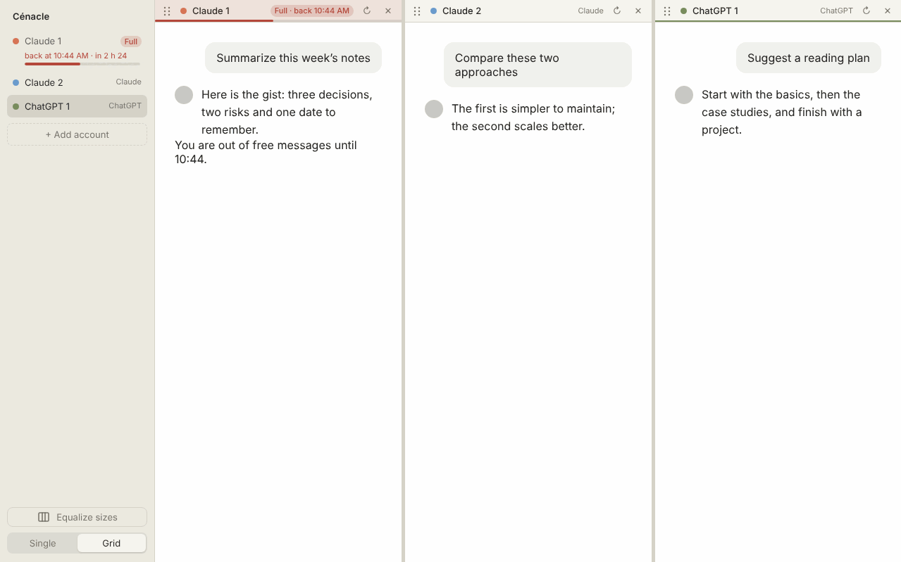

# Using Cénacle

**English** · [Français](fr/usage.md)

← [Back to the README](../README.md)

## The basics

- **+ Add account** asks which service, then creates an empty session. Sign in once; it is kept between launches.
- **Single / Grid**: one account at a time, or several at once in a layout you arrange (handy to compare answers). See [The grid](grid.md).
- Double-click a name (or ✎) to rename, ✕ to delete an account's session.
- **Filter and group by service**: once you have accounts of at least two services, chips above the list show each service with its account count. Click one to list only that service's accounts (click it again, or **All**, to see everything), and use **Group** to bring accounts of the same service together. This only changes the sidebar list: the grid, the shortcut numbers and the order of your accounts stay as they are. The filter and the grouping are kept between launches.
- **Window**: on first launch it fills the usable area of the screen (below the menu bar and the Dock, or the taskbar). After that the app restores its last size, or its maximized / full-screen state. If the screen it was on has been unplugged, it comes back on the main display.
- Full screen: green button (macOS), ⌃⌘F / F11 or the View menu. Maximize: double-click the top bar (macOS) or the title bar (Windows, Linux).
- Hidden accounts stay loaded, so their conversations keep running in the background.
- **View → Development → Resource usage** shows the memory and CPU taken by each account, what is shared (interface, graphics, network) and the total, refreshed every 2 seconds. Useful to see which account weighs the most; an account whose page is not loaded yet shows a dash. Figures are approximate.
- **Hold ⌘ (macOS) or Ctrl (Windows, Linux)** for a moment: the shortcut number of each account (⌘1…⌘9 / Ctrl+1…9) appears next to its name, in the sidebar and above each cell of the grid.
- **Notifications**: a web notification raised by a service shows the account's name in its title and the account's color dot as its icon, so you know which account it comes from. Clicking it brings the app forward on that account. If you are not looking at that account when it notifies, a dot appears next to its name (and above its column) until you open it, the Dock icon bounces (macOS) or the taskbar entry flashes (Windows, Linux), and the app badge shows how many accounts are waiting (macOS Dock, Linux Unity launcher). Nothing appears? **View → Development → Test notifications…** tells whether the system displays them.
- **Right-click** in a service page opens a context menu: cut / copy / paste, spelling suggestions, open or copy a link, copy an image, inspect element.

## Shortcuts

On macOS ⌘ is the Command key; on Windows and Linux use Ctrl instead.

| Shortcut                  | Action                                |
| ------------------------- | ------------------------------------- |
| ⌘1 … ⌘9 / Ctrl+1 … 9      | Go to account n                       |
| Ctrl+Tab / Ctrl+Shift+Tab | Next / previous account               |
| ⌘⇧L / Ctrl+Shift+L        | Toggle single / grid                  |
| ⌘R / Ctrl+R               | Reload the active account             |
| ⌘+ ⌘- ⌘0 / Ctrl+ + - 0    | Zoom the active account               |
| ⌘⌥I / Ctrl+Alt+I          | Developer tools of the active account |
| ⌃⌘F (macOS) / F11         | Full screen                           |

New account: Accounts → New account in the menu, or the sidebar button.

## Usage limits (Claude)

When Claude's page tells you that you are close to, or at, your usage limit, Cénacle shows it for that account, in the sidebar and in the cell header:

_An account at its limit, in the sidebar and in its cell header. Page content is demo text._

- a **pill**: "90%+" (more than 90 % of the limit used) or "Full" (limit reached);
- the time the limit **comes back**, the time left, and an hourglass bar drawn against the 5-hour window (it turns green when the limit is about to come back);
- a **notification**, with the account's name and color, when a limit that was reached is reset.

The banner is recognized by what it says (a short text that names a limit and gives a time of day), not by the page's markup, in English or in French. Only that sentence is read; it is parsed on your computer and never leaves it. The limit stays shown until its reset time even if the page stops displaying the banner. Claude only, for now.

## Language

The interface is available in English and French. It follows the system language and falls back to English for any other language.
